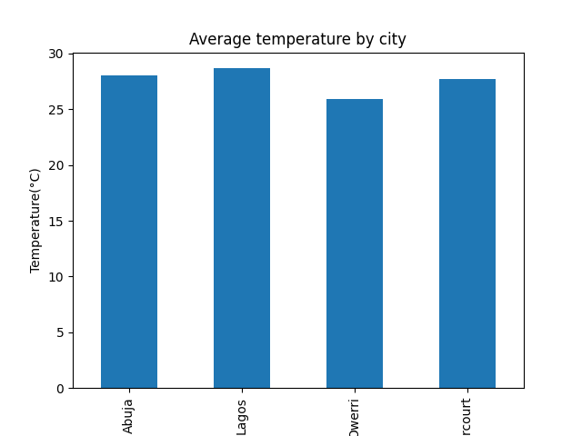
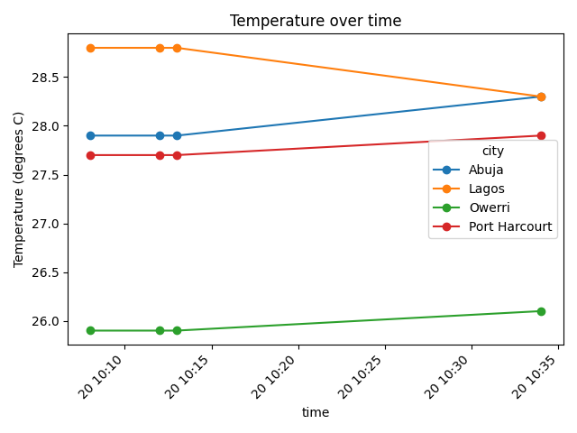

# weather-analysis

Analysis of temperature readings for four Nigerian cities (Lagos, Abuja, Owerri, Port Harcourt), collected automatically with Python and the Open-Meteo API.

## What it does

- Loads the readings from a JSON log with pandas
- Removes duplicate readings
- Calculates the average temperature per city
- Draws a bar chart of the averages and a line chart of temperature over time

## Charts





## Setup

```
pip install pandas matplotlib
```

## How to run

Change the log path in `weather_analysis.py` to your own `weather_log.json`, then run:

```
python weather_analysis.py
```

## Related project

The data is collected by my Weather Logger project, which runs daily with Windows Task Scheduler.

## Author

Victor Amuta
